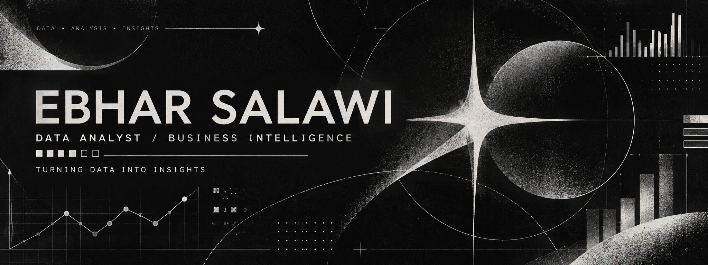

 

 

EBHAR SALAWI &nbsp; / &nbsp; PERSONAL DIGITAL ARCHIVE &nbsp; / &nbsp; 2026

  

# DATA ANALYST
### BUSINESS INTELLIGENCE · DATA MINING

`DISCOVER` &nbsp; `ANALYZE` &nbsp; `INTERPRET` &nbsp; `EVOLVE`

[ABOUT](#01--profile) &nbsp; ◆ &nbsp; [EXPERTISE](#02--expertise) &nbsp; ◆ &nbsp; [PROJECTS](#03--selected-works) &nbsp; ◆ &nbsp; [CONTACT](#06--contact)

---

## 01 / PROFILE

**Hello, I'm Ebhar Salawi.**

An Information Technology graduate from Jazan University, specializing in Data Mining.

I am interested in transforming raw data into meaningful insights through analytical thinking, statistical methods, and business intelligence tools.

My focus is on building practical analytical solutions that support data-driven decision-making.

`LOCATION` Saudi Arabia  
`EDUCATION` B.Sc. Information Technology  
`SPECIALIZATION` Data Mining  
`GPA` 4.26 / 5.00 — Second-Class Honors

---

## 02 / EXPERTISE

| DOMAIN | TOOLS & TECHNOLOGIES |
|:---|:---|
| PROGRAMMING | Python · SQL |
| DATA ANALYSIS | Pandas · Statistics · EDA |
| VISUALIZATION | Power BI · Excel |
| DATABASES | SQL · Database Analysis |
| STATISTICAL TOOLS | SPSS |
| FRONT-END | HTML · CSS · Figma |

---

## 03 / SELECTED WORKS

### PROJECT / 001
**STUDENT ATTENDANCE ANALYSIS**

`POWER BI` `POWER QUERY` `DAX` `DATA ANALYSIS`

An analytical project focused on identifying factors influencing student absenteeism and transforming collected data into actionable insights.

- Analyzed 73 survey responses.
- Cleaned and transformed data using Power Query.
- Developed an interactive dashboard with key metrics and KPIs.
- Presented analytical findings and recommendations.

[EXPLORE PROJECT →](https://github.com/Ebhar03/Student-Attendance-Analysis)

---

### PROJECT / 002
**CHATGPT IMPACT ANALYSIS**

`PYTHON` `PANDAS` `SPSS` `STATISTICAL ANALYSIS`

An analytical study exploring the impact of AI tools on student behavior and academic achievement.

- Collected more than 100 survey and interview responses.
- Processed 18 variables using Python and Pandas.
- Conducted statistical analysis using SPSS.
- Developed research findings and recommendations.

[EXPLORE PROJECT →](https://github.com/Ebhar03/chatgpt-impact-analysis)

---

### PROJECT / 003
**CARESTANOVA**

`HTML` `CSS` `FRONT-END DEVELOPMENT`

A digital storytelling website presenting graduates' journey through the job-search experience.

- Designed and developed responsive website pages.
- Applied front-end development principles.
- Created a visual storytelling experience.

[EXPLORE PROJECT →](https://github.com/Ebhar03/CARESTA-NOVA-website)

---

## 04 / EXPERIENCE

**DATA ANALYSIS & BUSINESS INTELLIGENCE TRAINEE**

Promising Future Institute for Higher Training

`JAN 2026 — MAY 2026`

- Data cleaning and exploratory analysis.
- Power BI dashboard development.
- KPI creation and performance monitoring.
- Analytical reporting and presentation.
- Data-driven recommendations for management.

---

## 05 / EDUCATION

**JAZAN UNIVERSITY**

Bachelor of Information Technology

Specialization: Data Mining

`2026` · GPA 4.26 / 5.00 · Second-Class Honors

---

## 06 / CONTACT

### LET'S CONNECT.

Interested in data analytics, business intelligence, and building meaningful solutions.

 

EBHAR SALAWI · DATA / ANALYSIS / INSIGHTS

DISCIPLINE · CURIOSITY · CONTINUOUS GROWTH

---

### Connect with Me
*  **LinkedIn:** [linkedin.com/in/ebhar-salawi](https://linkedin.com/in/ebhar-salawi)
* 📧 **Email:** [Ebharsalawi@gmail.com](mailto:Ebharsalawi@gmail.com)
